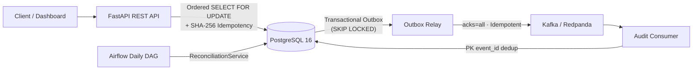

# PayFlow

[](https://github.com/ShivanshHingve2804/PayFlow/actions/workflows/ci.yml)
[](https://www.python.org/)
[](https://fastapi.tiangolo.com/)
[](https://www.postgresql.org/)
[](https://redpanda.com/)
[](LICENSE)

**ACID-compliant 8-currency fintech payment API featuring ordered pessimistic row locking, race-safe idempotency fingerprinting, transactional Kafka outbox streaming, and Airflow daily ledger reconciliation.**

PayFlow prevents overdraft races and AB-BA deadlocks with sorted PostgreSQL `SELECT ... FOR UPDATE` locks, guarantees zero dual-write split-brain via a transactional outbox relayed to Kafka/Redpanda with a primary-key deduplicating consumer, and audits daily balance conservation via an Airflow reconciliation DAG.

---

## Verified Highlights

- **Ordered Pessimistic Locking ([`app/services/locking.py`](app/services/locking.py)):** Sorts target account IDs before acquiring PostgreSQL `SELECT ... FOR UPDATE` row locks, backed by `CHECK` constraints (`balance >= 0`, `amount > 0`). Proven in 20-thread live PostgreSQL stress tests (`5/20` overdraft winners, `0` AB-BA deadlocks across bidirectional races).
- **Race-Safe Idempotency Fingerprinting ([`app/services/locking.py`](app/services/locking.py)):** Hashes `(operation, accounts, normalized amount)` via SHA-256, resolves concurrent `IntegrityError` races cleanly, and raises `DuplicateTransactionError` (`HTTP 409`) when a key is reused with conflicting parameters. Proven in 20-thread simultaneous idempotency storms (`1` debit, `1` outbox event, `0` errors).
- **Complete 8-Currency FX Matrix & Minor-Unit Guards ([`app/currency.py`](app/currency.py)):** Seeds all **56 directed pairs** across `USD`, `EUR`, `GBP`, `INR`, `JPY`, `AUD`, `CAD`, and `CHF`; rejects sub-unit input amounts (`0` decimals for `JPY`, `2` for others); and persists `target_amount`, `target_currency`, and `exchange_rate` on `Transaction`.
- **Transactional Outbox & Deduplicating Kafka Consumer ([`app/streaming/kafka_worker.py`](app/streaming/kafka_worker.py)):** Commits `OutboxEvent` rows atomically with ledger mutations, relays batches via `FOR UPDATE SKIP LOCKED` to Kafka/Redpanda (`acks=all`, `enable.idempotence=True`), and deduplicates deliveries in `processed_events` (`52/52` events relayed & consumed end-to-end with `0` pending).
- **Airflow Daily Reconciliation ([`airflow/dags/daily_reconciliation_dag.py`](airflow/dags/daily_reconciliation_dag.py), [`app/services/reconciliation_service.py`](app/services/reconciliation_service.py)):** Daily `@daily` DAG recomputes account balances from `initial_balance` + immutable transaction legs (`DEPOSIT`, `TRANSFER`, `EXCHANGE`), verifies outbox completeness, and persists `ReconciliationReport` audit logs (`PASSED` / `DISCREPANCY`).
- **43 Automated Tests (`87.16%` Coverage) & CI ([`.github/workflows/ci.yml`](.github/workflows/ci.yml)):** Runs `ruff`, `mypy`, Alembic migrations against live PostgreSQL 16, multi-threaded Postgres contention tests, and Docker `container-build` verification.

---

## Architecture



| Decision | Rationale |
|---|---|
| **Sorted `SELECT ... FOR UPDATE` on account IDs** | Acquiring row locks in deterministic ascending order prevents circular wait across concurrent `A -> B` and `B -> A` transfers. |
| **Transactional Outbox instead of post-commit dual-write** | Writing `OutboxEvent` in the same database transaction as balance updates ensures events are never lost on crash or split-brain broker outage. |
| **Consumer PK deduplication (`processed_events`)** | Manual Kafka offset commits after `ProcessedEvent` insert give idempotent exactly-once audit processing over at-least-once broker delivery. |
| **Alembic migrations + currency minor-unit validation** | Explicit versioned schema (`alembic/`) avoids multi-worker `create_all()` races while `currency.py` guards `JPY` (`0` decimals) and 2-decimal currencies uniformly. |

---

## Tech Stack

| Layer | Technologies |
|---|---|
| **API & Domain** | Python 3.11 / 3.12, FastAPI, Pydantic v2, SQLAlchemy 2.0 (`psycopg` v3), Alembic |
| **Database & Consistency** | PostgreSQL 16 (`SELECT ... FOR UPDATE`, `SKIP LOCKED`, `CHECK` constraints) |
| **Event Streaming** | Kafka / Redpanda (`confluent-kafka` idempotent producer + manual-commit consumer) |
| **Batch Reconciliation** | Apache Airflow `@daily` DAG (`payflow_daily_ledger_reconciliation`) + `ReconciliationService` |
| **Testing & DevOps** | pytest (43 tests), Ruff, mypy, Docker Compose (Postgres, Redpanda, API, workers, Airflow profile), GitHub Actions |

---

## Quick Start

### 1. Boot the Stack (PostgreSQL + Redpanda + API + Workers)

```bash
docker compose up -d --build
# API Docs:  http://localhost:8000/docs
# Dashboard: http://localhost:8000/dashboard
# Health:    http://localhost:8000/health
```

*(Optional)* Start the Airflow reconciliation scheduler UI (`http://localhost:8080`):
```bash
docker compose --profile airflow up -d
```

### 2. Local Development & Tests

```bash
pip install -e ".[dev]"
export DATABASE_URL=sqlite:///./payflow.db
alembic upgrade head
uvicorn app.main:app --reload --port 8000

# Lint, typecheck, and run tests (set PAYFLOW_POSTGRES_TEST_URL for Postgres contention suite)
make lint
make test
```

---

## API Overview

Full request/response contracts are documented in **[`docs/API.md`](docs/API.md)**.

| Domain | Endpoints |
|---|---|
| **Health & UI** | `GET /`, `GET /health`, `GET /dashboard` |
| **Accounts** | `GET/POST /api/v1/accounts/`, `GET /api/v1/accounts/{id}`, `GET /api/v1/accounts/{id}/balance`, `POST /api/v1/accounts/{id}/deposit` |
| **Transfers & Ledger** | `GET/POST /api/v1/transfers/`, `GET /api/v1/transfers/{id}` |
| **Multi-Currency FX** | `GET /api/v1/exchange/rates`, `POST /api/v1/exchange/` |
| **Reconciliation & Outbox** | `POST /api/v1/reconciliation/run`, `GET /api/v1/reconciliation/reports`, `GET /api/v1/reconciliation/outbox` |

---

## Further Reading

- **[`docs/ARCHITECTURE.md`](docs/ARCHITECTURE.md)** — Locking topology, idempotency hash semantics, transactional outbox, and reconciliation workflow
- **[`docs/API.md`](docs/API.md)** — Complete endpoint reference, query filters, and status codes
- **[`docs/CONCURRENCY_AND_BENCHMARKS.md`](docs/CONCURRENCY_AND_BENCHMARKS.md)** — Verified 20-thread Postgres contention results, 50-transfer latency (`p50=24.18 ms`, `p95=37.77 ms`), and live Redpanda/Kafka delivery logs
