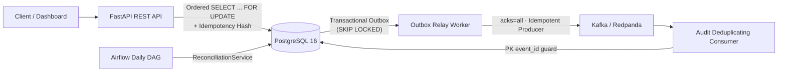

# PayFlow Architecture

## System Overview

---

## Core Engineering Guarantees

### 1. Ordered Pessimistic Row Locking (`app/services/locking.py`)
- Multi-account operations (`TransferService.create_transfer`, `ExchangeService.create_exchange`) normalize and sort target IDs (`sorted(set(account_ids))`) before issuing `SELECT ... FOR UPDATE` on PostgreSQL.
- Because concurrent `A -> B` and `B -> A` transfers always acquire `min(A, B)` first, circular wait is impossible (**AB-BA deadlock prevention**).
- Database-level `CHECK` constraints enforce `balance >= 0`, `initial_balance >= 0`, `amount > 0`, and `rate > 0` as a final safety net.

### 2. Race-Safe Idempotency Fingerprinting (`app/services/locking.py`)
- Blank `idempotency_key` strings are rejected at validation (`422`), eliminating empty-string unique-index collisions.
- Every idempotent operation computes a canonical SHA-256 `request_hash` across `(operation, accounts, normalized amount)`.
- Replays with matching `request_hash` return the original persisted `Transaction` (`201`). Reusing an `idempotency_key` with different parameters raises `DuplicateTransactionError` (**HTTP `409 Conflict`**).
- Concurrent races past the initial check catch `IntegrityError`, roll back cleanly, re-read the committed record, and verify `request_hash` rather than leaking `500` errors.

### 3. Multi-Currency Minor-Unit Precision (`app/currency.py`)
- Supports **8 ISO-4217 currencies** (`USD`, `EUR`, `GBP`, `INR`, `JPY`, `AUD`, `CAD`, `CHF`) with a complete **56-pair** cross-rate matrix seeded atomically at startup.
- Inputs exceeding each currency's minor unit (`0` decimals for `JPY`; `2` decimals for the remaining 7 currencies) are rejected rather than truncated.
- Exchanges persist full dual-currency audit telemetry (`amount`, `currency`, `target_amount`, `target_currency`, `exchange_rate`) on `Transaction`.

### 4. Transactional Outbox + Kafka Deduplicating Consumer (`app/streaming/kafka_worker.py`)
- Every deposit, transfer, and exchange stages an `OutboxEvent` row inside the **same ACID PostgreSQL transaction** as the balance mutation, preventing dual-write split-brain on broker failures.
- `OutboxRelay` claims pending rows with `SELECT ... FOR UPDATE SKIP LOCKED`, publishes JSON envelopes via an idempotent Kafka producer (`acks=all`, `enable.idempotence=True`), and transitions rows to `PUBLISHED`.
- `AuditEventConsumer` disables Kafka auto-commit, inserts `ProcessedEvent(event_id)` as a primary-key deduplication barrier, and commits Kafka offsets only after durable persistence — delivering exactly-once audit processing over at-least-once broker delivery.

### 5. Airflow Daily Ledger Reconciliation (`airflow/dags/daily_reconciliation_dag.py`)
- Daily DAG `payflow_daily_ledger_reconciliation` (`@daily`) invokes `ReconciliationService.run_daily_reconciliation()` to recompute expected balances from `initial_balance` plus all `DEPOSIT`, `TRANSFER`, and `EXCHANGE` ledger legs.
- Audits outbox backlog (`PENDING` count), persists immutable `ReconciliationReport` rows (`PASSED` vs `DISCREPANCY`), and fails the Airflow task immediately on balance drift.
